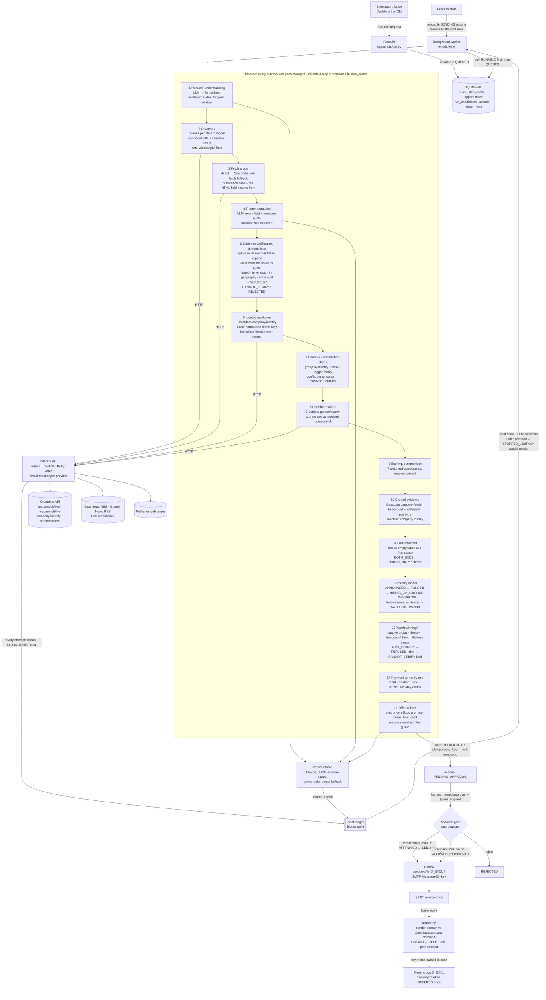

# SignalHunt: Architecture

## Where each required concern lives

| Concern | Where | How |
|---|---|---|
| Data calls | `sources/crustdata.py`, `sources/news_rss.py`, `sources/fetcher.py` | All through `net.request` |
| Retries | `net.py` | 2 retries, exponential backoff, honours `Retry-After`, 408/425/429/5xx only; circuit breaker after 3 consecutive failures → next provider |
| Fallbacks | `agents/discovery.py`, `sources/fetcher.py`, `llm.py` | Crustdata → Bing RSS → Google RSS; direct fetch → Crustdata fetch; LLM → rules/template |
| Cost ledger | `runtime.py` (`RunContext.record`), `ledger` table | Every attempt: provider, operation, status, latency, units (tokens / Crustdata `X-Credits-Used`), USD |
| Limits | `runtime.py` (`check_limits`, `check_llm_budget`) | Cost, active seconds (survives restarts), LLM calls, articles per run |
| Crash recovery | `runtime.RunContext.step`, `workflow.Worker` | Memoized steps in `step_cache`; RUNNING runs resumed on boot |
| Exactly-once actions | `approvals.py` | UNIQUE idempotency key, conditional state transitions, O_EXCL outbox, `reconcile()` on boot |
| Approval | `approvals.approve` | Named approver + human-typed recipient required; nothing sends otherwise |
| Evidence | `agents/verifier.py` | Deterministic verbatim-quote check; facts without a source never reach the output |
| Explainability | `agents/scoring.py` | Fixed weights, per-component reason, assumptions in every report |
| Capacity match | `agents/lanes.py`, `agents/ground.py` | Both-ends rule from Crustdata headcount-by-region and postings; cluster aliases (Chakan → Pune, Oragadam → Chennai) |
| Reality ladder | `agents/ladder.py` | Rung from dated source wording plus postings at the site in the last 60 days |
| Trust verdict | `agents/trust.py` | Captive groups (config), identity, six-month headcount trend, distress headlines naming the exact company |
| Payment terms | `agents/terms.py` | Pure rules; every tier carries reasons |
| Reply and booking | `replies.py` | Impostor check, time parsing, capacity lock, `.ics` with O_EXCL, reply row keyed on (action, sender, text) |
| Contact rule | `approvals.recipient_allowed` | `ALLOWED_RECIPIENTS` allow-list; nothing outside it is ever sent |
